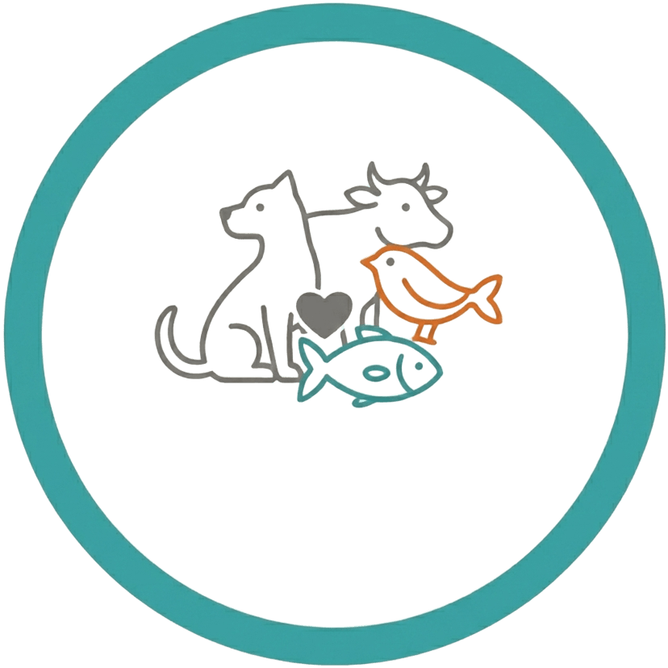
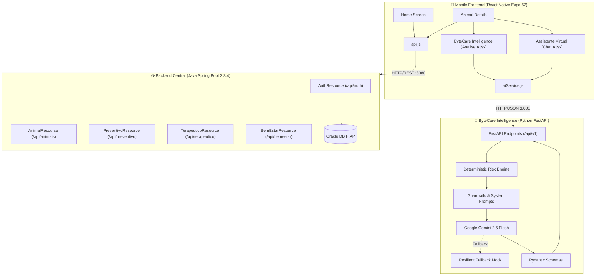

# ByteCare — Arquiteturas Disruptivas: IoT, IoB & IA Generativa

<div align="center">



**Global Solution 2º Semestre — FIAP**  
*Ecossistema Integrado de Saúde Animal com Inteligência Artificial Preditiva e Generativa*

[](https://openjdk.org/)
[](https://spring.io/projects/spring-boot)
[](https://www.python.org/)
[](https://fastapi.tiangolo.com/)
[](https://expo.dev/)
[](https://ai.google.dev/)
[]()

---

### 🔗 Links Oficiais da Entrega
**Repositório GitHub:** [https://github.com/Gutemberg149/bytecare-api-ai-2sem](https://github.com/Gutemberg149/bytecare-api-ai-2sem)  
**Vídeo Pitch no YouTube (Não Listado):** [https://youtu.be/SEU_VIDEO_AQUI](https://youtu.be/SEU_VIDEO_AQUI) *(Consulte [docs/VIDEO_PITCH_SCRIPT.md](docs/VIDEO_PITCH_SCRIPT.md) para o roteiro completo de 5 min)*

</div>

---

## 📋 Sumário Executivo

O **ByteCare** é uma solução completa para a gestão e acompanhamento contínuo da saúde animal, desenvolvida no âmbito da disciplina de *Disruptive Architectures: IoT, IoB & Generative IA*.

O projeto conecta **tutores de animais (pets, agro e aves)** e **clínicas veterinárias** por meio de um ecossistema digital composto por:
1. **Backend RESTful em Java Spring Boot:** Gerencia a persistência relacional corporativa em banco de dados Oracle, segurança com JWT e endpoints dos módulos de cuidados.
2. **Microserviço de IA ByteCare Intelligence em Python FastAPI:** Implementa uma **arquitetura híbrida de IA** com motor de regras determinístico, salvaguardas ético-veterinárias, integração com Google Gemini e fallback resiliente.
3. **Aplicativo Mobile React Native Expo:** Interface moderna para Android/iOS com fluxo de navegação fluido, painel analítico com cálculo de risco em tempo real e chatbot de triagem médica interativa.

---

## 🎯 Problema de Negócio e Proposta de Valor

### O Problema
- **Fragmentação da Informação:** Tutores perdem receitas, laudos e datas de reforço vacinal, prejudicando o histórico clínico do animal.
- **Baixa Adesão Terapêutica:** Esquecimento ou interrupção prematura de tratamentos com antibióticos e anti-inflamatórios.
- **Identificação Tardia de Riscos:** Tutores demoram a reconhecer sinais sutis de dor, prostração ou intoxicação, procurando o veterinário apenas quando o caso se torna emergencial.

### A Solução ByteCare
O ByteCare estrutura o acompanhamento animal em **três pilares clínicos longitudinais**:
- 🛡️ **Pilar Preventivo:** Vacinação, vermifugação, antiparasitários e check-ups periódicos.
- 💊 **Pilar Terapêutico:** Medicamentos ativos, posologia, horários, duração e controle de adesão diária.
- 🐾 **Pilar de Bem-Estar:** Peso, escore de condição corporal, hidratação, nutrição e observações comportamentais.

### Benefícios Diretos
| Para o Tutor | Para as Clínicas e Médicos-Veterinários |
| :--- | :--- |
| Centralização de todos os registros em um só app. | Pacientes chegam com anamnese prévia e histórico confiável. |
| Copiloto de triagem preventiva 24/7 com IA. | Redução drástica do abandono de tratamentos prescritos. |
| Detecção imediata de sinais de risco com alerta de urgência. | Apoio à conformidade com a Resolução CFMV nº 1.488/2022. |

---

## 🧠 Arquitetura Técnica de IA (Critérios da GS)

### Por que uma Arquitetura Híbrida de IA?
Modelos de linguagem generativos (LLMs) possuem alta capacidade de comunicação humana, mas são suscetíveis a **alucinações probabilísticas**, o que é inaceitável em aplicações de saúde animal.

Por essa razão, o ByteCare implementou rigorosamente uma **Arquitetura Híbrida de Dois Níveis**:

```
[Dados do Histórico / Mensagem do Tutor]
                   │
                   ▼
  ┌────────────────────────────────────────────────────────┐
  │   1. MOTOR DETERMINÍSTICO DE REGRAS (risk_engine.py)   │
  │   - Varredura de palavras-chave vitais                 │
  │   - Cálculo matemático de score objetivo               │
  │   - Classificação estrita: NORMAL / MODERADO / URGENTE │
  │   - Força flag: procurar_veterinario = true            │
  └────────────────────────┬───────────────────────────────┘
                           │ Risco & Salvaguardas Travadas
                           ▼
  ┌────────────────────────────────────────────────────────┐
  │   2. IA GENERATIVA COM GUARDRAILS (gemini_service.py)   │
  │   - Google Gemini 2.5 Flash / Pro                      │
  │   - System Prompt com restrições do CFMV               │
  │   - Proibição de diagnóstico médico conclusivo         │
  │   - Proibição de prescrição farmacológica              │
  │   - Structured Outputs via Pydantic Schemas            │
  │   - Fallback automático para Mock com paridade total   │
  └────────────────────────┬───────────────────────────────┘
                           │
                           ▼
        [Resposta Estruturada JSON Consumida pelo Mobile]
```

### Principais Componentes Técnicos
1. **Motor de Risco (`risk_engine.py`):**
   - Avalia registros de vacinas atrasadas (> 365 dias) e termos clínicos de alta gravidade (*convulsão, hemorragia, atropelamento, choque, dispneia*).
   - O risco gerado é determinístico e **imune a manipulação via prompt injection**.
2. **Guardrails Veterinários Estritos (`prompt.py`):**
   - Cumprimento da **Resolução CFMV nº 1.488/2022**: a IA recusa explicitamente substituir a consulta clínica presencial.
   - Linguagem descritiva e orientativa, nunca diagnóstica ou prescritiva.
3. **Structured Outputs com Pydantic v2 (`schemas.py`):**
   - Toda resposta da API adere aos modelos `AnaliseSaudeResponse` ou `ChatResponse`, garantindo tipagem forte, campos previsíveis e serialização segura.
4. **Resiliente Fallback (`mock_service.py`):**
   - Caso a chave de API não esteja configurada ou ocorra oscilação de rede, o sistema ativa um mock inteligente determinístico que espelha 100% dos campos e comportamento do Gemini.

---

## 🐶 Personalização Multiespécie

O ByteCare suporta personalização dinâmica para múltiplas espécies animais:

| Categoria | Espécie | Foco Clínico e Sanitário | Tom da IA |
| :--- | :--- | :--- | :--- |
| **Pets** | Cães | V8/V10, Antirrábica, prevenção de ectoparasitas, controle de torção gástrica. | Empático, rotina familiar e passeios. |
| **Pets** | Gatos | Quádrupla/Quíntupla (FeLV), controle de estresse urinário, hidratação. | Focado em comportamento sutil e enriquecimento ambiental. |
| **Agro** | Bovinos | Aftosa, Brucelose, Clostridioses, controle de mastite e ruminação. | Técnico, zootécnico e focado em sanidade de lote. |
| **Agro** | Equinos | Tétano, Influenza, Encefalomielite e alerta absoluto para síndrome cólica. | Alerta imediato e rigoroso para claudicação e cólica. |
| **Pássaros** | Aves | Manejo de gaiola, respiração com bico aberto e sintomas de prostração. | Sensível à fragilidade metabólica das aves. |
| **Pets** | Peixes | Parâmetros de aquário: pH, amônia tóxica, nitrito e temperatura. | Educativo sobre parâmetros de água e ciclagem biológica. |

---

## 🏛️ Diagramas do Sistema

### Arquitetura Geral de Componentes


---

## 📸 Demonstração do Aplicativo (Capturas de Tela Reais)

<div align="center">

| Tela Inicial (Home) | Perfil do Animal (BAU) |
| :---: | :---: |
|  |  |

| ByteCare Intelligence (Análise de Saúde) | Chat com Salvaguarda de Emergência |
| :---: | :---: |
|  |  |

</div>

---

## 🚀 Como Executar Localmente

### 1. Iniciar o Backend Java (Porta 8080)
```powershell
cd bytecare-api-ai-2sem/backend
.\mvnw.cmd spring-boot:run
```
*Health check:* `http://localhost:8080/health`

### 2. Iniciar a API de IA em Python (Porta 8001)
```powershell
cd bytecare-api-ai-2sem/ai
pip install -r requirements.txt
python -m uvicorn app.main:app --host 0.0.0.0 --port 8001
```
*Health check:* `http://localhost:8001/api/v1/health`

### 3. Configurar Emulador e Iniciar o Mobile Expo
```powershell
# Redirecionar portas para o emulador Android
adb reverse tcp:8080 tcp:8080
adb reverse tcp:8001 tcp:8001
adb reverse tcp:8081 tcp:8081

# Iniciar o Expo no Android
cd bytecare-api-ai-2sem/mobile
npm install
npx expo start --android
```

### 4. Credenciais Homologadas para Teste
- **Usuário:** `admin`
- **Senha:** `123456`

---

## 🧪 Testes Automatizados

Para executar os testes unitários do motor determinístico e salvaguardas da IA:
```powershell
cd bytecare-api-ai-2sem/ai
python -m unittest discover -s tests -v
```

---

## 👥 Equipe e Estrutura de Entrega

- **Repositório Unificado:** `bytecare-api-ai-2sem`
- **Documentação de Arquitetura:** [docs/ARCHITECTURE.md](docs/ARCHITECTURE.md)
- **Roteiro do Pitch de 5 Minutos:** [docs/VIDEO_PITCH_SCRIPT.md](docs/VIDEO_PITCH_SCRIPT.md)
- **Guia Detalhado de Instalação:** [docs/LOCAL_SETUP.md](docs/LOCAL_SETUP.md)
- **Arquivo de Submissão:** [SUBMISSION_LINKS.txt](SUBMISSION_LINKS.txt)

*ByteCare — Cuidando de quem sempre cuida de você.*
