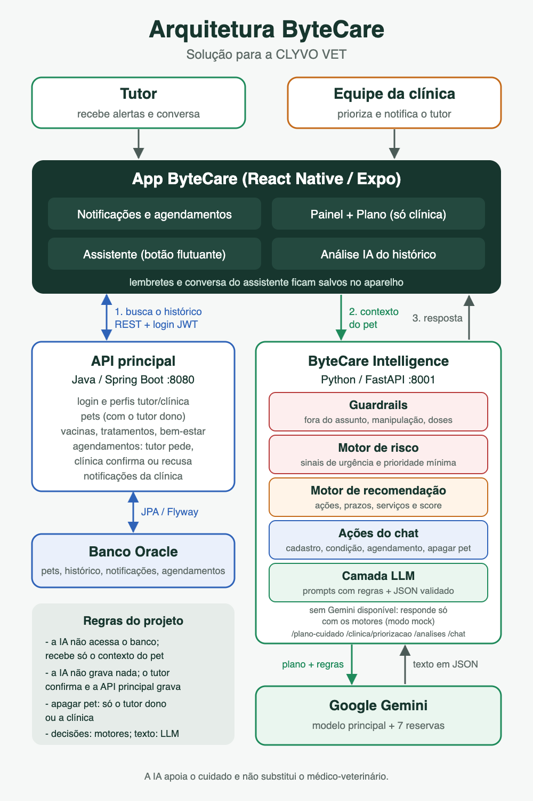
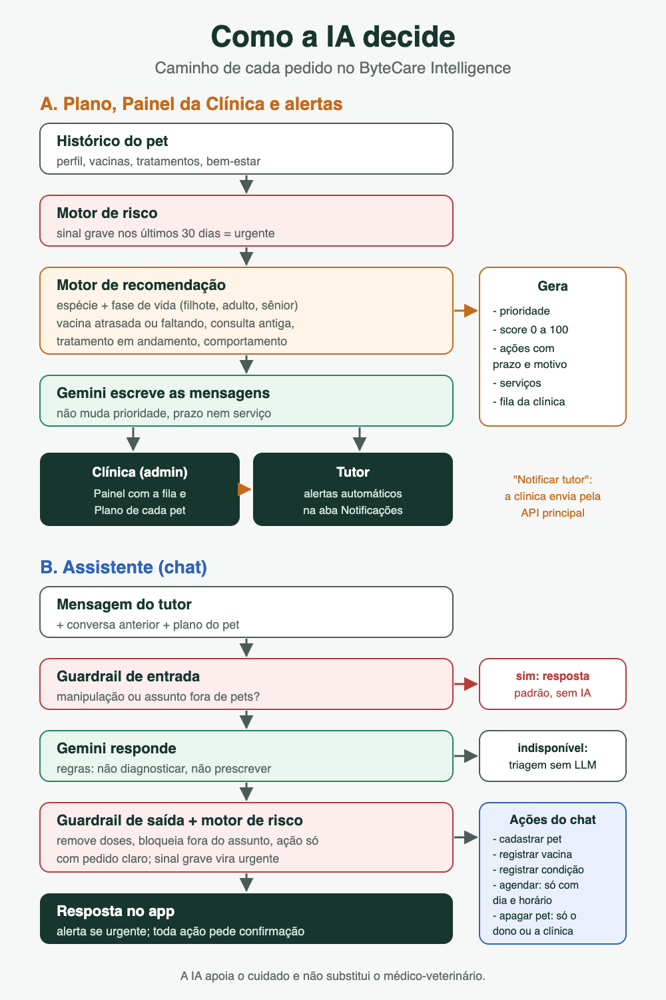

# ByteCare Intelligence API

Componente de Inteligência Artificial do **ByteCare**, solução desenvolvida para a **CLYVO VET** na disciplina **Disruptive Architectures: IoT, IoB & Generative IA** (Sprint 3).

## Links

- Vídeo no YouTube (não listado): _adicionar o link após a publicação_
- GitHub: https://github.com/guhstr/bytecare-api-ai-2sem

## Integrantes

- RM 565771 - Erik Naoki
- RM 561650 - Gustavo Sartori
- RM 562267 - Gutemberg Rocha
- RM 564361 - João Henrique
- RM 561171 - Juliana da Silva

## Problema

Na jornada de cuidado do pet, o cuidado costuma ser **reativo**: o tutor só procura a clínica quando algo já deu errado.

- vacinas e reforços vencem sem que o tutor perceba;
- tratamentos prescritos são interrompidos ou esquecidos;
- mudanças de comportamento e de peso passam despercebidas;
- a clínica não sabe quais pacientes precisam de contato primeiro e trata todos da mesma forma.

O **ByteCare Intelligence** usa IA para transformar o histórico do pet em um **plano de cuidado contínuo, personalizado e priorizado**, ajudando o tutor a saber o que fazer e quando, e ajudando a clínica a decidir quem atender e qual serviço oferecer.

A solução não substitui avaliação veterinária.

## Solução

A API possui quatro funcionalidades principais:

### Plano de cuidado personalizado (tutor)

Recebe o perfil do pet e seu histórico (vacinas, preventivos, tratamentos, consultas, bem-estar e comportamento) e devolve:

- perfil de personalização (espécie, fase de vida, vacinas essenciais registradas e pendentes);
- **ações priorizadas**, cada uma com prioridade, prazo em dias, motivo e dados de origem;
- **serviços da clínica recomendados**, com score de relevância;
- score de risco de 0 a 100;
- mensagem personalizada para o tutor e resumo para a clínica.

### Priorização de pacientes (clínica)

Recebe vários pets e devolve uma **fila ordenada por prioridade e score**, com o motivo principal, a ação sugerida para a equipe (ex.: contatar em até 48h) e os serviços a oferecer.

### Análise do histórico

Organiza os registros preventivos, terapêuticos e de bem-estar em um resumo estruturado com prioridade, fatores relevantes, próximos passos e sinais de atenção.

### Assistente ByteCare

Chat que usa a mensagem do usuário, o histórico da conversa e o contexto do pet para orientar, identificar situações de atenção e retornar ações estruturadas (cadastrar pet, registrar vacina, registrar condição, pedir agendamento, listar e apagar pets).

- mantém o contexto da conversa: não repete perguntas já respondidas;
- recebe o plano de cuidado calculado pelo motor, para que chat e análise digam a mesma coisa;
- no app, fica acessível por um botão flutuante em todas as telas logadas e guarda a conversa de cada pet no aparelho;
- toda ação sugerida pelo chat só é gravada depois da confirmação no app;
- no assistente geral (aberto pela Home), citar um pet cadastrado pelo nome ("apaga o Draco", "o Thor está mancando") troca o contexto para esse pet e carrega o histórico dele.

#### Ações pelo chat

A IA não grava nada: ela devolve o campo `acao` com os dados, o app mostra uma janela de confirmação e a API principal grava.

| Ação (`acao`) | Exemplo de pedido | Regra |
|---|---|---|
| `cadastrar_animal` | "quero cadastrar meu gato Mingau, siamês, 10 meses" | pergunta só o que faltar (nome, espécie, raça, idade), inclusive em respostas em lista ("Thor, sem raça definida, 5 anos"); vacinas já tomadas (com a próxima dose) e sinais de saúde ditos no meio do cadastro vão para o histórico logo depois, com confirmação; o pet novo vira o contexto da conversa |
| `cadastrar_vacina` | "registra a V10 do Thor" | só com pet identificado e intenção clara de salvar |
| `registrar_observacao` | "registra que ele tem uma pata a menos" | vai para o bem-estar do pet; condição permanente (amputação, alergia, doença crônica) também entra nas observações do cadastro e passa a ser considerada no plano |
| `agendar` | "quero marcar consulta e vacina sexta às 14h" | só envia com dia **e** horário (ou "qualquer dia"); dia e horário vêm da conversa, nunca do modelo; a clínica confirma ou recusa e o tutor é notificado |
| `listar_animais` | "quais são os meus pets?" | só leitura; o app busca na API principal os pets do usuário (a clínica vê todos). Também há um botão de patinha no topo do assistente |
| `apagar_animal` | "apaga o Draco" | só com pedido explícito e pet aberto; o app confere se o usuário é o tutor que cadastrou o pet ou a clínica, e a API principal confere de novo (403 para os demais); histórico e agendamentos do pet também são apagados |

### Guardrails do assistente

| Camada | O que faz |
|---|---|
| Entrada | Bloqueia tentativas de mudar as regras ("ignore as instruções", "mostre o system prompt") e assuntos fora de saúde e cuidado animal, sem chamar o LLM |
| Prompt | Escopo restrito, regras protegidas contra manipulação, proibição de diagnóstico, prescrição e doses |
| Saída | Respostas marcadas como fora do escopo são substituídas; respostas com dose (mg, ml, gotas, comprimidos) são trocadas por uma orientação segura |
| Risco | Sinais de urgência sempre elevam a resposta para "urgente", mesmo que o LLM discorde |
| Ações | Só com pet identificado e confirmação no app; agendamento exige dia e horário; apagar pet só com pedido explícito, e o modelo não dispara essa ação sozinho |

## IA utilizada

A solução utiliza uma **arquitetura híbrida**:

| Camada | Abordagem | Papel |
|---|---|---|
| Motor de recomendação | Sistema de recomendação baseado em regras inteligentes | Decide ações, prazos, serviços, score e prioridade |
| Motor de risco | Regras determinísticas + guardrails | Detecta sinais de urgência e define prioridade mínima |
| Camada LLM | IA Generativa (Google Gemini) com System Prompt e Structured Output (Pydantic) | Personaliza a linguagem para o tutor e para a clínica, conduz o chat |

**Por que híbrida?** Em saúde animal, decisões de prioridade precisam ser **explicáveis, auditáveis e repetíveis**. Um LLM sozinho pode inventar datas ou reduzir a gravidade de um sinal. Por isso as decisões ficam no motor determinístico e o LLM atua onde ele é melhor: linguagem natural, empatia e conversação. O LLM **nunca** altera prioridade, prazo ou serviço recomendado.

Também não usamos um modelo preditivo treinado porque o projeto ainda não possui uma base histórica rotulada (desfechos clínicos) suficiente. A arquitetura já registra os dados necessários para evoluir para esse modelo no futuro.

A IA é orientada a:

- não diagnosticar;
- não prescrever;
- não inventar informações;
- não alterar tratamentos prescritos;
- recomendar atendimento veterinário quando necessário.

Detalhes em [docs/ARCHITECTURE.md](docs/ARCHITECTURE.md).

## Personalização

A personalização considera:

- **espécie**: calendário de vacinas por espécie e fase de vida para cães, gatos, equinos, bovinos e galinhas; para papagaio, calopsita, canário, coelho e peixe (sem vacinas de rotina no Brasil), orientação preventiva própria. A espécie exata vem da subcategoria do app, da raça ou da conversa (o tipo PASSARO reúne várias aves);
- **fase de vida**: filhote, adulto ou sênior, com limites por espécie (ex.: cão sênior a partir de 7 anos, gato a partir de 10);
- **histórico**: vacinas atrasadas ou a vencer, tratamentos em andamento, tempo desde a última consulta;
- **comportamento e bem-estar**: alterações de comportamento, peso, dentes, pele e parasitas geram ações e serviços específicos.

Exemplo: um cão sênior sem consulta há mais de 6 meses recebe "check-up sênior" e "exames laboratoriais"; um filhote sem vacina essencial recebe prioridade alta e prazo de 7 dias.

## Dados utilizados

| Dado | Origem | Utilização |
|---|---|---|
| Perfil do pet (espécie, raça, nascimento, peso, castração) | API principal / Oracle | Personalização e fase de vida |
| Vacinas e preventivos | API principal / Oracle | Pendências, atrasos e lembretes |
| Tratamentos e medicamentos | API principal / Oracle | Adesão e consulta de retorno |
| Consultas | Clínica | Check-up periódico |
| Bem-estar e comportamento | Registros do tutor no app | Sinais de atenção, serviços específicos |
| Histórico do chat e mensagem atual | App | Contexto da conversa e avaliação de risco |
| Agendamentos (serviços, dia, horário, status) | API principal / Oracle (tabela AGENDAMENTO) | Pedido do tutor pelo chat e resposta da clínica |
| Tutor do pet | API principal / Oracle (coluna ANIMAL.TUTOR) | O tutor só vê e gerencia os próprios pets; a clínica vê todos com o nome do tutor; notificação da clínica vai para o dono |

Dicionário completo em [docs/DADOS.md](docs/DADOS.md).

## Arquitetura

<p align="center">
  
  
</p>

```text
Tutor / Clínica CLYVO VET
  ↓
ByteCare Mobile (React Native / Expo)
  ├── API Java / Spring Boot (:8080)
  │       ↓
  │     Oracle
  │
  └── ByteCare Intelligence / FastAPI (:8001)
          ├── Motor de recomendação
          ├── Motor de risco + guardrails
          ├── System Prompt + Pydantic
          ↓
        Google Gemini
```

A API de IA não acessa diretamente o Oracle. O aplicativo obtém os dados pela API Java e envia somente o contexto necessário para o serviço de IA.

## Endpoints

```text
GET  /api/v1/health
GET  /api/v1/servicos
POST /api/v1/plano-cuidado
POST /api/v1/clinica/priorizacao
POST /api/v1/analises
POST /api/v1/chat
```

Swagger:

```text
http://127.0.0.1:8001/docs
```

Exemplos de requisição prontos na pasta [examples](examples).

## Tecnologias

- Python
- FastAPI
- Pydantic
- Google Gemini
- Google Gen AI SDK
- Uvicorn
- python-dotenv
- unittest

Telas do app mobile que usam esta API:

| Tela | Endpoint | O que mostra |
|---|---|---|
| Painel da Clínica (Home, só admin) | `/clinica/priorizacao` | fila de todos os pets por prioridade e botão "Notificar tutor" |
| Plano de Cuidado (no pet, só admin) | `/plano-cuidado` | prioridade, score, ações com prazo, serviços recomendados |
| Notificações (sino na Home) | `/clinica/priorizacao` + API principal | mensagens da clínica, alertas automáticos da IA e lembretes do tutor |
| Análise IA (no pet) | `/analises` | resumo estruturado do histórico |
| Assistente (botão flutuante) | `/chat` | conversa com memória, guardrails e ações com confirmação |
| Agendamentos (Home) | API principal | tutor acompanha e cancela; clínica confirma, recusa e apaga |

Integrações utilizadas na demonstração:

- React Native / Expo
- Spring Boot
- Oracle

## Estrutura

```text
bytecare-api-ai-2sem/
├── app/
│   ├── main.py
│   ├── schemas.py
│   ├── care_engine.py
│   ├── risk_engine.py
│   ├── prompt.py
│   ├── guardrails.py
│   ├── llm.py
│   ├── gemini_service.py
│   ├── chat_service.py
│   ├── cadastro.py
│   ├── observacao.py
│   ├── agendamento.py
│   ├── remocao.py
│   └── mock_service.py
├── tests/
│   ├── test_care_engine.py
│   ├── test_risk_engine.py
│   ├── test_chat.py
│   ├── test_guardrails.py
│   ├── test_cadastro.py
│   ├── test_observacao.py
│   ├── test_agendamento.py
│   ├── test_remocao.py
│   ├── test_vacinas_especies.py
│   └── test_api.py
├── examples/
│   ├── plano_cao_senior.json
│   ├── plano_gato_urgente.json
│   └── priorizacao_clinica.json
├── docs/
│   ├── ARCHITECTURE.md
│   ├── DADOS.md
│   ├── LOCAL_SETUP.md
│   ├── arquitetura.png
│   └── fluxo-ia.png
├── .env.example
├── .gitignore
├── requirements.txt
└── README.md
```

## Como executar

Acesse a pasta:

```bash
cd bytecare-api-ai-2sem
```

Crie e ative o ambiente virtual:

```bash
python3 -m venv .venv
source .venv/bin/activate
```

No Windows:

```powershell
.venv\Scripts\activate
```

Instale as dependências:

```bash
pip install -r requirements.txt
```

Crie o `.env`:

```bash
cp .env.example .env
```

Configure:

```env
BYTECARE_AI_MODE=gemini
GEMINI_API_KEY=SUA_CHAVE_GEMINI
GEMINI_MODEL=gemini-3.5-flash
GEMINI_FALLBACK_MODELS=gemini-3.6-flash,gemini-3.7-flash,gemini-3.8-flash,gemini-3-flash-preview,gemini-3.1-flash-lite,gemini-3.5-flash-lite,gemini-flash-latest
CORS_ORIGINS=*
```

Se o modelo principal estiver sobrecarregado, sem cota ou descontinuado, a API tenta os modelos de `GEMINI_FALLBACK_MODELS` na ordem (até 15 s por modelo e 30 s no total). A cota do plano gratuito é separada por modelo, por isso a lista tem sete reservas: primeiro os que falham rápido quando sem cota, por último os que costumam demorar. Se nenhum responder, usa o modo mock, e o app nunca fica sem resposta.

Inicie a API:

```bash
uvicorn app.main:app --reload --host 0.0.0.0 --port 8001
```

Health Check:

```text
http://127.0.0.1:8001/api/v1/health
```

Teste o plano de cuidado:

```bash
curl -X POST http://127.0.0.1:8001/api/v1/plano-cuidado \
  -H "Content-Type: application/json" \
  -d @examples/plano_cao_senior.json
```

Para subir o sistema completo (API Java, esta API e o app mobile), veja [docs/LOCAL_SETUP.md](docs/LOCAL_SETUP.md).

## Modo Mock

Para executar sem utilizar o Gemini:

```env
BYTECARE_AI_MODE=mock
```

Nesse modo o plano de cuidado e a priorização continuam completos, pois as decisões são do motor determinístico; apenas os textos para tutor e clínica usam modelos fixos. Se o Gemini estiver configurado mas indisponível, o plano de cuidado usa automaticamente esses textos.

## Testes

```bash
python3 -m unittest discover -s tests -v
```

Os testes validam:

- personalização por espécie e fase de vida;
- vacinas essenciais pendentes e reforços atrasados;
- sinais recentes elevando a prioridade para urgente (e registros antigos tratados como histórico);
- ordenação das ações e da fila da clínica;
- que o LLM não reduz uma prioridade mínima já definida;
- memória do chat (não repetir perguntas, negações como "não vomitou");
- guardrails: manipulação, assuntos fora do escopo, doses e urgência;
- ações do chat: cadastro de pet, registro de condição, agendamento só com dia e horário, lista de pets e pedido para apagar o pet (sem confundir com apagar agendamento ou vacina);
- os endpoints da API.

## Resultados

A versão atual possui:

- plano de cuidado personalizado com ações priorizadas e prazos;
- recomendação de serviços da clínica com score;
- fila de priorização de pacientes para a clínica;
- personalização por espécie e fase de vida;
- análise estruturada do histórico;
- chatbot contextual;
- integração com Google Gemini com Structured Output;
- motor de risco e guardrails de segurança;
- modos `mock` e `gemini`;
- assistente com memória de conversa e guardrails de escopo, manipulação e doses;
- ações pelo chat com confirmação: cadastrar pet, vacina, condição, agendamento, listar e apagar pets;
- fallback entre oito modelos Gemini;
- 81 testes automatizados;
- teste integrado com dados reais da API Java (12 pets do banco Oracle priorizados pela IA).

**ByteCare Intelligence: cuidado contínuo, personalizado e seguro para cada pet.**
