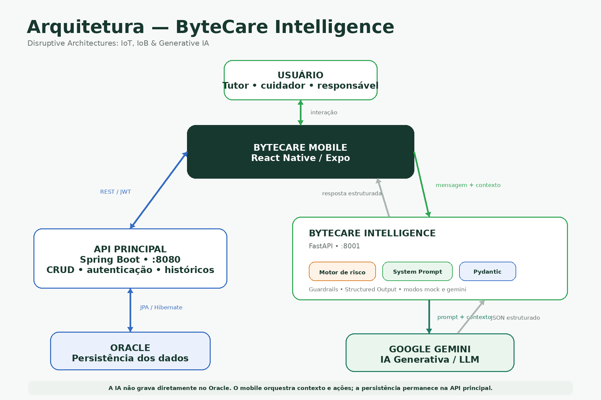

# ByteCare Intelligence API

Componente de Inteligência Artificial do **ByteCare**, desenvolvido para a disciplina **Disruptive Architectures: IoT, IoB & Generative IA**.

## Links

- Vídeo no YouTube: https://youtu.be/L-smQjqk0OI
- GitHub: https://github.com/guhstr/bytecare-api-ai.git

## Integrantes

- RM 565771 - Erik Naoki
- RM 561650 - Gustavo Sartori
- RM 562267 - Gutemberg Rocha
- RM 564361 - João Henrique
- RM 561171 - Juliana da Silva

## Problema

O histórico de saúde animal pode ficar dividido entre vacinas, tratamentos, registros preventivos e informações de bem-estar.

O **ByteCare Intelligence** utiliza IA para organizar esse contexto, gerar análises personalizadas e ajudar o responsável a identificar situações que merecem atenção.

A solução não substitui avaliação veterinária.

## Solução

A API possui duas funcionalidades principais:

### Análise do histórico

Recebe o perfil do animal e seus registros preventivos, terapêuticos e de bem-estar.

A solução combina:

- regras determinísticas de risco;
- Google Gemini;
- Structured Output com Pydantic;
- guardrails de segurança.

O resultado contém informações como prioridade, resumo, fatores relevantes, próximos passos e sinais de atenção.

### Assistente ByteCare

O chatbot utiliza a mensagem do usuário, histórico recente da conversa e contexto do animal.

Ele pode:

- responder perguntas sobre o histórico;
- identificar situações de atenção;
- manter contexto conversacional;
- retornar ações estruturadas para integração com o aplicativo;
- auxiliar no cadastro de animal e registro de vacina.

## IA utilizada

A solução utiliza uma arquitetura híbrida:

- IA Generativa baseada em LLM.
- **Google Gemini** para interpretação e geração das respostas;
- **System Prompt** para definir regras de comportamento;
- **Pydantic** para validar a resposta estruturada;
- **motor determinístico de risco**;
- **guardrails** para impedir respostas inseguras.

A IA é orientada a:

- não diagnosticar;
- não prescrever;
- não inventar informações;
- não alterar tratamentos prescritos;
- recomendar atendimento veterinário quando necessário.

## Personalização multiespécie

O ByteCare Intelligence pode trabalhar com diferentes espécies, como:

- cães;
- gatos;
- aves;
- equinos;
- bovinos;
- outros animais cadastrados no ByteCare.

A personalização considera informações como espécie, raça, idade, preventivos, vacinas, tratamentos e bem-estar.

## Dados utilizados

| Dado | Utilização |
|---|---|
| Perfil do animal | Personalização |
| Espécie, raça e idade | Contextualização |
| Preventivos e vacinas | Histórico preventivo |
| Tratamentos | Continuidade do cuidado |
| Bem-estar | Acompanhamento |
| Histórico do chat | Contexto da conversa |
| Mensagem atual | Intenção e avaliação de risco |

## Arquitetura



```text
Usuário
  ↓
ByteCare Mobile
  ├── API Java / Spring Boot
  │       ↓
  │     Oracle
  │
  └── ByteCare Intelligence / FastAPI
          ├── Motor de risco
          ├── System Prompt
          ├── Pydantic
          ├── Guardrails
          ↓
        Google Gemini
```

A API de IA não acessa diretamente o Oracle. O aplicativo obtém os dados pela API Java e envia somente o contexto necessário para o serviço de IA.

## Endpoints

```text
GET  /api/v1/health
POST /api/v1/analises
POST /api/v1/chat
```

Swagger:

```text
http://127.0.0.1:8001/docs
```

## Tecnologias

- Python
- FastAPI
- Pydantic
- Google Gemini
- Google Gen AI SDK
- Uvicorn
- python-dotenv
- unittest

Integrações utilizadas na demonstração:

- React Native / Expo
- Spring Boot
- Oracle

## Estrutura

```text
bytecare-ai-api/
├── app/
│   ├── main.py
│   ├── schemas.py
│   ├── prompt.py
│   ├── risk_engine.py
│   ├── gemini_service.py
│   ├── chat_service.py
│   └── mock_service.py
├── tests/
│   └── test_risk_engine.py
├── docs/
│   └── arquitetura.png
├── .env.example
├── .gitignore
├── requirements.txt
└── README.md
```

## Como executar

Acesse a pasta:

```bash
cd bytecare-ai-api
```

Crie e ative o ambiente virtual:

```bash
python3 -m venv .venv
source .venv/bin/activate
```

No Windows:

```powershell
.venv\Scripts\activate
```

Instale as dependências:

```bash
pip install -r requirements.txt
```

Crie o `.env`:

```bash
cp .env.example .env
```

Configure:

```env
BYTECARE_AI_MODE=gemini
GEMINI_API_KEY=SUA_CHAVE_GEMINI
GEMINI_MODEL=gemini-2.5-flash
CORS_ORIGINS=*
```

Inicie a API:

```bash
uvicorn app.main:app --reload --host 0.0.0.0 --port 8001
```

Health Check:

```text
http://127.0.0.1:8001/api/v1/health
```

## Modo Mock

Para executar sem utilizar o Gemini:

```env
BYTECARE_AI_MODE=mock
```

## Testes

```bash
python3 -m unittest discover -s tests -v
```

Os testes validam regras importantes do motor de risco e impedem que o LLM reduza uma prioridade mínima já definida.

## Resultados

A versão atual possui:

- análise estruturada do histórico;
- chatbot contextual;
- personalização multiespécie;
- integração com Google Gemini;
- Structured Output com Pydantic;
- motor de risco;
- guardrails de segurança;
- integração com ByteCare Mobile;
- cadastro estruturado de animal;
- registro de vacina;
- modos `mock` e `gemini`.

**ByteCare Intelligence — acompanhamento inteligente e seguro da saúde animal.**