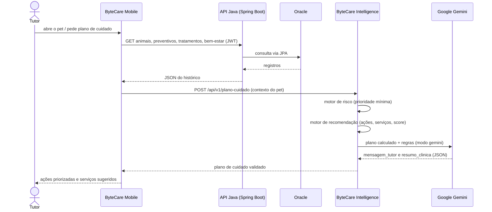
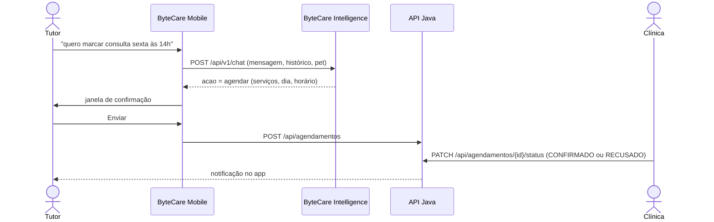
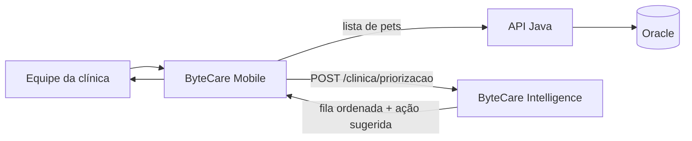
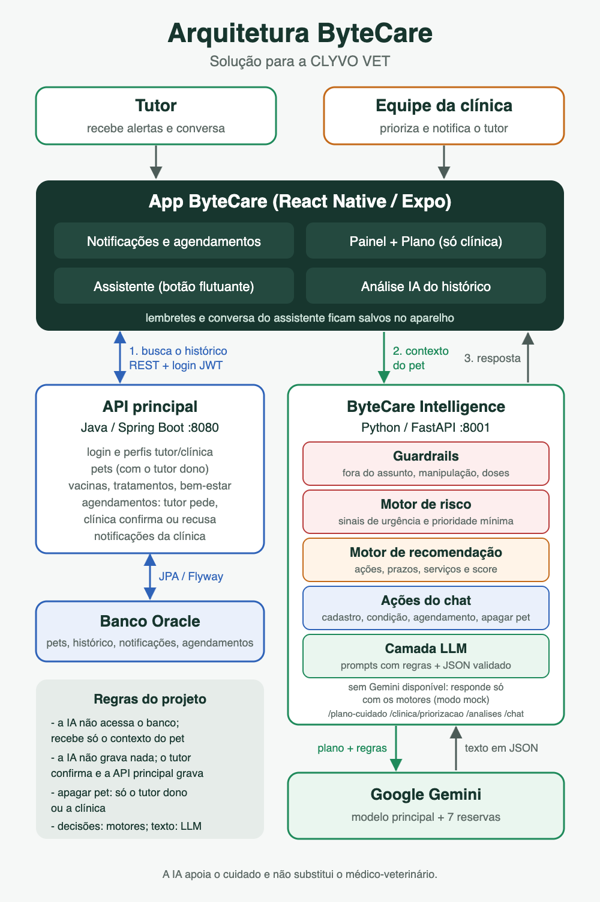
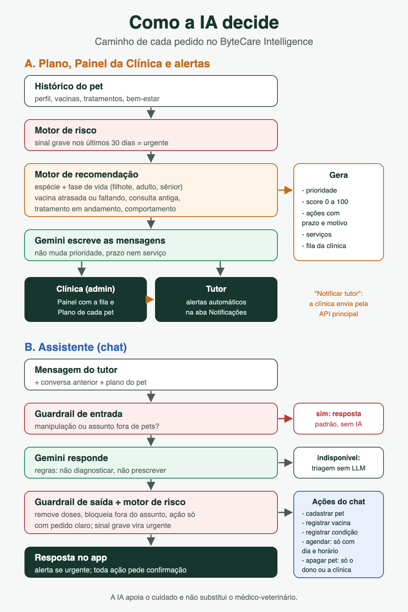

# Arquitetura do componente de IA

ByteCare Intelligence - solução ByteCare para a CLYVO VET.

## 1. Problema de negócio

A CLYVO VET quer acompanhar o pet de forma **contínua**, e não apenas quando ele adoece. Hoje esse acompanhamento falha em três pontos:

1. **Tutor**: não sabe o que precisa ser feito nem quando. Vacinas vencem, tratamentos são interrompidos e sinais de alerta são minimizados.
2. **Clínica**: tem muitos pacientes e nenhuma forma simples de saber quem precisa de contato primeiro. O relacionamento é igual para todos.
3. **Pet**: sofre as consequências do cuidado reativo (doenças evitáveis, diagnóstico tardio).

A IA resolve esse problema transformando o histórico do pet em **decisões de cuidado**:

| Público | Valor entregue |
|---|---|
| Tutor | Plano claro do que fazer e quando, em linguagem acessível, adaptado ao seu pet |
| Clínica | Fila de pacientes priorizada, motivo de cada contato e serviço a oferecer |
| Pet | Prevenção em dia, tratamentos seguidos e sinais de urgência encaminhados cedo |

## 2. Como a IA contribui

| Objetivo do GS | Como foi atendido |
|---|---|
| Personalização | Perfil por espécie e fase de vida; protocolo de vacinas por espécie; mensagens com o nome e contexto do pet |
| Priorização de ações | Cada ação recebe prioridade (baixa, moderada, alta, urgente) e prazo em dias; lista ordenada |
| Recomendação de serviços | Catálogo de 12 serviços da clínica com score de 0 a 100 e motivo |
| Apoio à decisão | Score de risco, fila priorizada da clínica e ação sugerida para a equipe |

## 3. Abordagem escolhida e justificativa

Foi adotada uma **arquitetura híbrida** que combina três abordagens citadas no enunciado:

### 3.1 Sistema de recomendação com motor de regras inteligentes (`care_engine.py`)

Decide **o que** deve ser feito. Regras explícitas, ponderadas por espécie, fase de vida e tempo:

- vacinas essenciais por espécie (ex.: cão: polivalente V8/V10 e antirrábica; equino: tétano, influenza, encefalomielite e antirrábica);
- comparação de `proximoPrevisto` com a data atual: vencido gera prioridade alta; a vencer em 30 dias gera lembrete;
- consulta de rotina anual, ou semestral para pets sênior;
- tratamento recente gera ação de adesão e consulta de retorno;
- termos de comportamento, peso, dentes, pele e parasitas geram serviços específicos;
- score = soma ponderada das ações (urgente 45, alta 20, moderada 10, baixa 3) + ajuste por fase de vida, limitado a 100.

**Justificativa:** as decisões precisam ser explicáveis (cada ação traz `motivo` e `origem_dados`), repetíveis e auditáveis por um veterinário. Isso não é garantido por um LLM.

### 3.2 Motor de risco e guardrails (`risk_engine.py`)

Detecta sinais de urgência (dificuldade respiratória, convulsão, intoxicação, trauma etc.) e define uma **prioridade mínima**. Só considera registros recentes (30 dias); registros antigos e tratamentos são tratados como histórico. A busca de termos respeita o início das palavras para evitar falsos positivos (ex.: "adora" não é "dor").

**Justificativa:** segurança. Nenhuma resposta da IA generativa pode reduzir a gravidade calculada.

### 3.3 IA Generativa / LLM (Google Gemini)

- No plano de cuidado: escreve a mensagem do tutor e o resumo da clínica a partir do plano já calculado.
- Na análise do histórico e no chat: interpreta o contexto, conversa e retorna JSON validado.

### 3.4 Ações pelo chat (`cadastro.py`, `observacao.py`, `agendamento.py`, `remocao.py`)

O chat pode sugerir ações, sempre com confirmação no app e gravação pela API principal:

| Ação | Módulo | Regra determinística |
|---|---|---|
| `cadastrar_animal` | `cadastro.py` | lê nome, espécie, raça e idade em meses da conversa; só sugere com os quatro dados |
| `cadastrar_vacina` | `chat_service.py` | só com pet identificado e intenção clara de registrar |
| `registrar_observacao` | `observacao.py` | tira o pedido ("registra que") e deixa a condição; marca como permanente amputação, alergia, doença crônica etc. |
| `agendar` | `agendamento.py` | serviços, dia e horário lidos da conversa; só envia com dia **e** horário (ou "qualquer dia"); o modelo nunca define a data |
| `listar_animais` | `remocao.py` | "quais são os meus pets": só leitura; o app monta a lista com a API principal (o tutor vê os dele, a clínica vê todos) |
| `apagar_animal` | `remocao.py` | só com pedido explícito ("apaga o Draco") e pet aberto; pedidos para apagar agendamento, vacina ou registro não contam; o modelo não dispara essa ação sozinho |

Os módulos funcionam nos dois modos: no `mock` decidem a resposta; no `gemini` entram como contexto do prompt e como guardrail de saída (completam a ação que o modelo esqueceu e removem a que ele inventou).

No assistente geral, o app procura na mensagem o nome de um pet cadastrado; se achar, troca o contexto da conversa para esse pet e envia o histórico dele para a IA.

Cada pet guarda o tutor que o cadastrou (coluna `ANIMAL.TUTOR`). A API principal filtra por ele: o tutor só lista, abre, altera e apaga os próprios pets (os demais recebem 404 ou 403); a clínica (ROLE_ADMIN) vê todos, com o nome do tutor, e o "Notificar tutor" vai só para o dono do pet. Como a IA recebe apenas os pets que o app consegue ler, o assistente e os alertas automáticos também ficam restritos aos pets do usuário. Ao apagar, o histórico e os agendamentos do pet também saem.

Usa System Prompt com regras (não diagnosticar, não prescrever, não inventar dados) e **Structured Output** com schemas Pydantic.

**Justificativa:** o LLM é a melhor ferramenta para linguagem natural, empatia e conversa, mas não deve tomar decisões clínicas.

### 3.5 Por que não um modelo preditivo treinado

Um modelo preditivo (ex.: risco de faltar à vacina) exige uma base histórica rotulada com desfechos, que o projeto ainda não possui. O motor de regras entrega valor desde o primeiro dia e, ao mesmo tempo, gera os dados (ações sugeridas, prioridades, registros) que permitirão treinar esse modelo em uma próxima etapa.

## 4. Fluxo de dados

Fluxo de uma ação pelo chat (exemplo: agendamento):

Fluxo da clínica:

Princípios:

- a IA **não acessa o banco**; recebe apenas o contexto necessário (minimização de dados);
- a IA **não grava dados**; as ações do chat (cadastrar pet, vacina, condição, agendamento, apagar pet) são confirmadas no app e gravadas pela API principal;
- todas as respostas passam por schemas Pydantic antes de chegar ao app.

## 5. Diagramas

  
  

O primeiro mostra os componentes e o que trafega entre eles; o segundo, o caminho de cada pedido dentro da IA.

| Componente | Tecnologia | Porta | Responsabilidade |
|---|---|---|---|
| ByteCare Mobile | React Native / Expo | - | Interface do tutor e orquestração das chamadas |
| API principal | Java 21 / Spring Boot 3.5 | 8080 | Autenticação JWT, CRUD de pets e históricos, agendamentos e notificações |
| Banco | Oracle (Flyway) | 1521 | Persistência |
| ByteCare Intelligence | Python / FastAPI | 8001 | Motores de recomendação e risco, camada LLM |
| LLM | Google Gemini 3.5 Flash (com 7 modelos reserva) | - | Linguagem natural e saídas estruturadas |

## 6. Segurança e ética

- não diagnostica, não prescreve, não altera doses;
- guardrails de entrada bloqueiam manipulação do prompt e assuntos fora de saúde animal antes de chamar o LLM;
- guardrails de saída substituem respostas fora do escopo ou com doses de medicamento;
- ações sugeridas pelo chat só são gravadas após confirmação no app; agendamento exige dia e horário; apagar pet exige pedido explícito e só vale para o tutor dono ou a clínica;
- prioridade mínima determinística que o LLM não pode reduzir;
- aviso de segurança em todas as respostas;
- modo `mock` permite rodar sem enviar dados para serviços externos;
- chaves de API apenas em `.env` (fora do Git).
