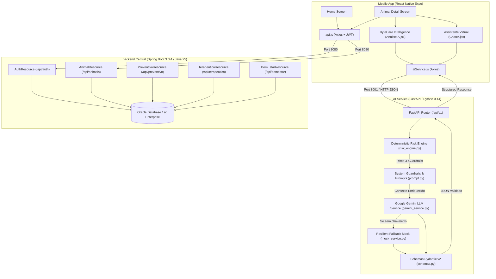
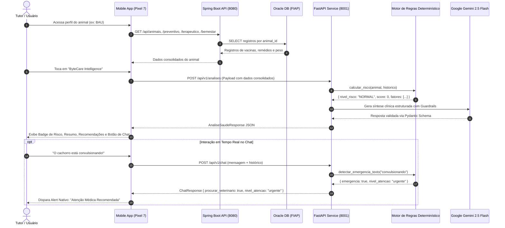

# ByteCare Intelligence — Arquitetura de IA e Fluxo de Dados

**Disciplina:** Disruptive Architectures: IoT, IoB & Generative IA  
**Projeto:** ByteCare (2º Semestre)  
**Repositório Unificado:** `bytecare-api-ai-2sem`  

---

## 1. Visão Geral e Contexto de Negócio

O ecossistema **ByteCare** foi desenvolvido para solucionar uma das maiores dores do mercado veterinário e de cuidados animais: a **fragmentação do histórico de saúde**, a **baixa adesão a tratamentos prescritos** e a **demora na identificação de sinais clínicos de risco**.

No modelo convencional:
- O tutor armazena exames e receitas de forma dispersa em papéis ou mensagens de texto.
- Esquecimentos de dosagens e atrasos vacinais colocam a vida do animal em risco.
- Na hora do atendimento clínico, o médico-veterinário perde tempo valioso reconstruindo o histórico anamnésico sem dados estruturados.

O ByteCare atua como uma plataforma unificada que conecta tutor e clínica através de três pilares centrais:
1. **Preventivo:** Calendários vacinais, controle de vermífugos, antiparasitários e check-ups periódicos.
2. **Terapêutico:** Gerenciamento de medicamentos prescritos, dosagens, horários, duração e controle de adesão.
3. **Bem-estar:** Registro de peso, escore corporal, dieta, hidratação, enriquecimento ambiental e alterações comportamentais.

A camada **ByteCare Intelligence** agrega a inteligência artificial generativa e determinística a esse ecossistema, transformando registros brutos em **resumos clínicos estruturados**, **triagens preventivas ágeis** e **alertas de risco em tempo real**.

---

## 2. Justificativa da Arquitetura Híbrida de IA

A aplicação de inteligência artificial na área da saúde veterinária exige rigor extremo. Modelos de linguagem (LLMs) puros sofrem de **alucinações**, **imprevisibilidade em dosagens** e **risco de emitir diagnósticos precipitados sem exame físico**.

Por essa razão, o ByteCare adota intencionalmente uma **Arquitetura Híbrida**, combinando:

1. **Motor Determinístico de Regras (`risk_engine.py`):**
   - Executa antes e independentemente de qualquer chamada ao LLM.
   - Aplica regras booleanas e pontuações matemáticas fixas sobre palavras-chave críticas (ex: *convulsão, hemorragia, atropelamento, cianose, choque*).
   - Avalia métricas objetivas (ex: vacinas com mais de 365 dias sem reforço geram risco moderado determinístico).
   - Classifica o risco em três níveis imutáveis por prompt injection: `NORMAL`, `MODERADO` ou `URGENTE`.
   - Força a ativação de `procurar_veterinario = true` e `aviso_seguranca` sempre que a pontuação ultrapassar o threshold de segurança.

2. **Modelo de Linguagem Generativo (Google Gemini 2.5 Flash / Pro):**
   - Responsável pela **humanização**, **empatia**, **contextualização multiespécie** e **síntese compreensível** para o tutor.
   - Opera sob um System Prompt ultra-estrito com guardrails regulatórios.
   - Utiliza **Structured Outputs** via schemas tipados do Pydantic (`AnaliseSaudeResponse`, `ChatResponse`), garantindo que o modelo nunca retorne texto livre solto, mas sim JSON estritamente validado.

3. **Fallback Resiliente com Mock Service (`mock_service.py`):**
   - Caso a chave de API não esteja configurada ou ocorra timeout de rede, a API aciona automaticamente um gerador sintético determinístico com **100% de paridade de esquema Pydantic**.
   - Garante que a aplicação mobile continue 100% operacional sem falhas em cascata.

---

## 3. Matriz de Personalização Multiespécie

O ByteCare não é restrito a cães e gatos. Ele foi concebido para atender **Pets convencionais, Animais de Produção (Agro) e Aves**, adaptando o tom e as diretrizes clínicas de acordo com a espécie:

| Espécie / Categoria | Foco Preventivo Principal | Parâmetros de Atenção Crítica | Tom e Conduta da IA |
| :--- | :--- | :--- | :--- |
| **Cães (Caninos)** | V8/V10, Antirrábica, Leishmaniose, Giardia, prevenção contra ectoparasitas. | Dilatação volvo-gástrica, tosse canina, vômito/diarreia com letargia, convulsão. | Empático, focado na rotina familiar, alertas de passeios e socialização. |
| **Gatos (Felinos)** | Quádrupla/Quíntupla (FelV), Antirrábica, controle de estresse urinário. | Obstrução uretral (anúria > 24h), perda de apetite > 24h (lipidose hepática), dispneia. | Sensível ao estresse felino, orientações de caixas de areia, enriquecimento vertical. |
| **Bovinos (Agro)** | Aftosa, Brucelose, Clostridioses, Raiva dos herbívoros, controle de mastite. | Timpanismo agudo, claudicação severa, prostração pós-parto, recusa de ruminação. | Técnico e zootécnico, focado no manejo de rebanho, sanidade e sustentabilidade. |
| **Equinos (Agro)** | Tétano, Influenza equina, Encefalomielite, Raiva, anemia infecciosa equina (AIE). | Síndrome cólica (emergência cirúrgica!), laminite, sudorese excessiva com dor. | Alerta imediato para cólica, ênfase no repouso, hidratação e médico de campo. |
| **Pássaros / Aves** | Higiene de gaiola, prevenção de coccidiose, carências nutricionais por sementes. | Aves disfarçam sintomas: penas eriçadas no chão da gaiola, respiração com bico aberto. | Alerta máximo para deterioração rápida; encaminhamento rápido a especialista. |
| **Peixes (Ornamentais)** | Parâmetros de água (pH, amônia tóxica, nitrito, temperatura, filtragem biológica). | Natação em parafuso, perda de escamas, respiração na superfície (hipóxia). | Educativo sobre química da água e ciclagem do aquário, sem prescrição de químicos. |

---

## 4. Guardrails e Conformidade Ético-Veterinária

O ByteCare opera em total alinhamento com a **Resolução CFMV nº 1.488/2022** (que regulamenta a telemedicina e suporte veterinário no Brasil):

- **Proibição Absoluta de Diagnóstico Conclusivo:** A IA jamais afirma categoricamente a patologia (ex: "Seu cão tem cinomose"). Ela utiliza formulações descritivas: *"Os sinais descritos coincidem com quadros gastroentéricos ou infecciosos que requerem avaliação presencial"*.
- **Proibição Absoluta de Prescrição Farmacológica:** A IA jamais indica nomes comerciais de medicamentos com tarja, nem sugere antibióticos, analgésicos ou anti-inflamatórios humanos (que são altamente tóxicos, como paracetamol para felinos).
- **Disclaimer Obrigatório em Toda Resposta:** Toda análise e mensagem de chat contém aviso explícito de que o ByteCare é ferramenta de suporte e acompanhamento histórico, não substituindo o médico-veterinário.

---

## 5. Diagramas da Solução

### 5.1 Diagrama de Arquitetura de Componentes

---

### 5.2 Diagrama de Fluxo de Dados — Triagem e Análise Clínica

